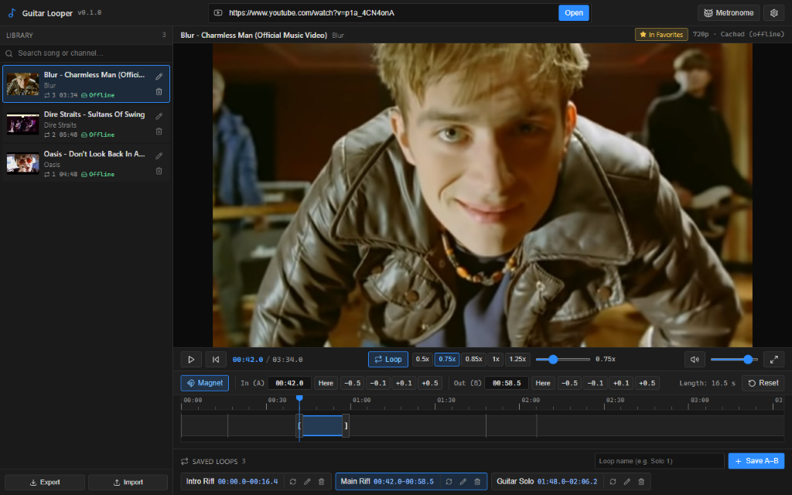

# Guitar YouTube Looper

A desktop Windows application for practicing guitar along with YouTube videos — featuring frame-accurate A–B looping on a Premiere-style magnetic timeline, pitch-preserving playback speed control, a built-in Web Audio metronome, and an offline-capable local MP4 cache.



## Features

- **YouTube Download & Offline MP4 Cache**
  - Paste any YouTube link (`youtube.com/watch?v=...`, `youtu.be/...`, `shorts/...`, with optional `?t=` timestamp).
  - Downloads video & audio via `yt-dlp` + `ffmpeg` as hardware-friendly **MP4 (H.264 / AAC)** in `480p`, `720p` (default), or `1080p`.
  - Streams cached files through an embedded Rust **HTTP `206 Partial Content` (Byte-Range)** server on `127.0.0.1` for instant, glitch-free `B → A` seeking and full offline playback.
  - Auto-downloads `yt-dlp.exe` if missing and includes an in-app **Update yt-dlp** button.
- **Premiere-Style A–B Timeline & Looping**
  - Seamless `requestAnimationFrame` A–B loop engine (`0.1s` precision, minimum `0.5s` loop length).
  - Adaptive time ruler, draggable **In (A)** / **Out (B)** brackets, magnetic snapping (`10px` threshold, hold `Alt` to temporarily bypass) to playhead, track edges, and saved loop boundaries.
  - Manual timecode input (`mm:ss.d`, `mm:ss`, `h:mm:ss.d`, or raw seconds like `83.5`), **Here** buttons, and `±0.1s` / `±0.5s` fine-nudge controls.
- **Pitch-Preserving Speed Control**
  - Continuous playback rate slider from `0.25x` to `2.00x` (`0.05x` steps) plus quick presets (`0.5x`, `0.75x`, `0.85x`, `1x`, `1.25x`) with pitch preservation enabled.
- **Built-In Metronome**
  - Compact top-bar popover powered by a Web Audio API lookahead scheduler (`30–300 BPM`, `±1` / `±5` steppers, volume slider).
- **Favorites Library & Named Loops**
  - Save songs to your local library (with optional custom titles) and search by song title or channel.
  - Create multiple named A–B loops per song (e.g., *Intro Riff*, *Main Riff*, *Guitar Solo*), apply in one click, update bounds, rename, or delete.
- **Backup & Cache Management**
  - Atomic JSON persistence (`library.json`, `settings.json`) under `%APPDATA%\GuitarLooper\`.
  - Export and import library backups as `.json` with **Merge** (deduplicated by `youtubeId` / `loopId`) or **Replace** modes.
  - Inspect disk cache usage (Favorites vs. Temporary) and clear either temporary files or the entire cache without deleting saved songs or loops.
- **Keyboard Shortcut**
  - `Space` toggles Play / Pause while the app window is focused (automatically ignored when typing in input fields or while dialogs are open).

## Tech Stack

- **Desktop Runtime:** Tauri v2 (Rust + Windows WebView2)
- **Frontend:** React 18, TypeScript, Vite, Lucide Icons
- **Media & Streaming:** `yt-dlp`, `ffmpeg`, embedded Rust HTTP `206` Byte-Range server
- **Audio:** Web Audio API lookahead metronome
- **Testing:** Vitest (frontend pure logic) + `cargo test` (Rust backend)

## Prerequisites (Development)

- **Windows 10 / 11** with WebView2
- **Node.js** `v22+`
- **Rust** (`rustc` / `cargo`) + Microsoft C++ Build Tools
- **FFmpeg** available in `PATH` (or placed in `%APPDATA%\GuitarLooper\bin\`)

## Getting Started

```powershell
# Install frontend dependencies
npm.cmd install

# Run the Tauri desktop app in development mode
npm.cmd run tauri dev

# Build a release Windows installer / executable
npm.cmd run tauri build
```

> **PowerShell note:** If Windows ExecutionPolicy blocks `npm.ps1`, run commands via `npm.cmd` / `npx.cmd`.

## Running Tests & Checks

```powershell
# TypeScript typecheck & frontend production build
npx.cmd tsc --noEmit
npm.cmd run build

# Frontend unit tests (Vitest)
npm.cmd test -- --run

# Rust backend check & tests
cargo check --manifest-path src-tauri/Cargo.toml
cargo test --manifest-path src-tauri/Cargo.toml
```

## Local Data Storage

All application state and cached media are stored locally under `%APPDATA%\GuitarLooper\`:

- `library.json` — saved favorite songs and named A–B loops (`schemaVersion: 1`)
- `settings.json` — default video quality and player volume
- `cache\<videoId>_<quality>.mp4` — cached MP4 videos for instant offline playback
- `bin\` — locally managed `yt-dlp.exe` / `ffmpeg.exe` binaries
